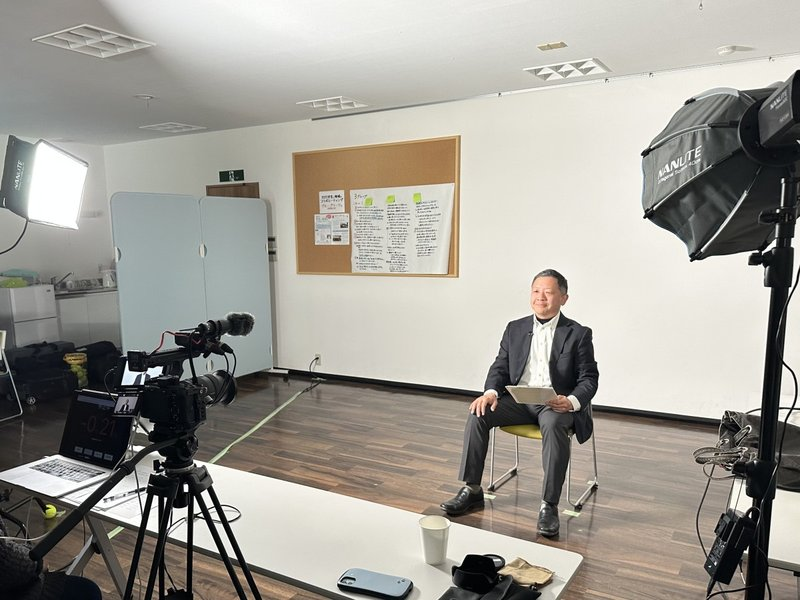
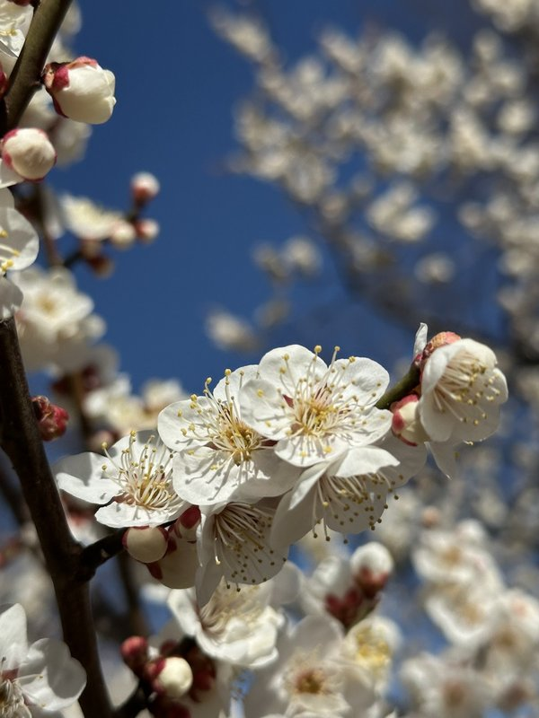

日増しに春の気配を感じる今日このごろですが、皆様いかがお過ごしでしょうか。

私は今、今月末に控えた大きな節目に向けて、目の前の課題に全力で取り組む日々を送っています。そんな中、昨日、少し緊張する体験をしてきました。上田の政治に関心を持つ若い世代の方々からお声がけをいただき、YouTube動画の撮影に参加してきたのです。

本格的な機材と、未来を見据える若者たちの真剣な眼差しを前に、私も思わず背筋が伸びました。動画は告示後に公開予定ですので、その際はまた改めてご案内させていただきます！

### 技術者の視点で、上田の仕組みを再設計したい

撮影では、私がなぜ今、上田のために動こうとしているのか、その想いを凝縮してお話ししました。

#### 現場の「負担」を「やりがい」に変える

自治会の会計（現在3年目）や、まちづくり協議会での活動を通じて痛感しているのは、地域を支える現場の事務負担の重さです。消防団や民生委員の皆様も含め、**今の仕組みは「善意」に頼りすぎ**ています。

ITの活用はもちろんですが、単にツールを導入するだけでなく、誰もが無理なく、誇りを持って参加できる**「仕組み」の再設計**が必要です。行政が現場に負担を押し付けるのではなく、共に歩む姿勢へ変えていくことを強く提案し、変化を確実なものとしてまいります。

#### ものづくりの誇りを次世代へ

38年9か月、精密機械の世界で設計に携わり、イギリスやアメリカでの駐在も経験しました。上田の強みは、この特異とも言える晴天率の高さが育んだ精密なものづくり文化です。

中世の刀鍛冶から「お蚕さん」の時代を経て、現代まで続くこの上田地域のものづくりを、単なる「下請け」ではなく、**高い付加価値を生む「誇りある産業」として再定義**することに力を注ぎます。行政が企業同士をつなぐ「ハブ」となり、この産業に携わる人の賃金や企業の価値が向上する仕組みを提案します。

### 「活性化で価値向上」— 上田の未来を明るく

上田市は広大で、地域ごとに抱える課題は様々です。例えば、私たち中山間地で暮らす者にとっては日常の移動手段、また田畑、山林、農業水路の健全な維持が切実な課題ですが、市街地の方には実感が湧きにくいかもしれません。その逆もまた然りです。20年前の合併によって市が広大になった結果、私たち市民が「自分たちが市政に参加している」という実感を持ちにくくなっているのではないでしょうか。この「当事者意識の希薄化」こそが、上田市の最も大きな問題であるとお答えしました。

ここで一つ大切なことがあります。

地域を歩き、いろいろな方と初めて会って、お話を伺うと、地域のために強い思いを持ち、熱心に発言されている方が何人もいらっしゃるのです。中には、親族の介護などの理由で地元へ戻られた、または縁あってこの地へ移ってこられた方も少なくありません。

こうした「外の視点」を持つ方の意見は、時に既存の慣習とぶつかり、強い摩擦を生むことがあります。しかし、私はその摩擦こそが、上田を変えるエネルギーになると信じています。

地域で活動する団体が、「来た人」からも良い意見は良い意見として柔軟に取り入れていく、多様な声を受け入れ、変化していくことも必要なのではないでしょうか。それができなければ、地域の衰退を止めることはできません。

外から来た人の感性と、地域を守ってきた人の知恵。この二つを掛け合わせることで、上田の「活性化」は本当の意味で始まります。摩擦があるのは課題解決にかける熱量があることの証拠であり、それを調整することが政治の役割だと思います。私は、その橋渡し役となり、古い仕組みをアップデートしていきたいのです。

### 梅の香りに癒されて

大緊張の収録を終えた後、少し足を伸ばして上田城跡公園へ向かいました。そこでは梅の花が見頃を迎えており、公園一帯が心地よい香りに包まれていました。

私にとっては人生でこれまで経験したことのない忙しない毎日ですが、季節の移ろいを感じる余裕を大切にしたいと感じました。皆様も、どうぞ春の訪れを楽しみながら、お健やかにお過ごしください。

しおいり友広（元・工作機械メーカー勤務・自動旋盤制御設計）

[各種のSNSはこちらからご覧いただけます。](https://shioiri.jp)
