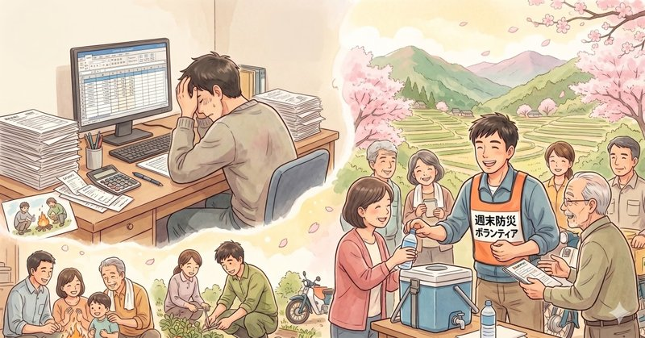
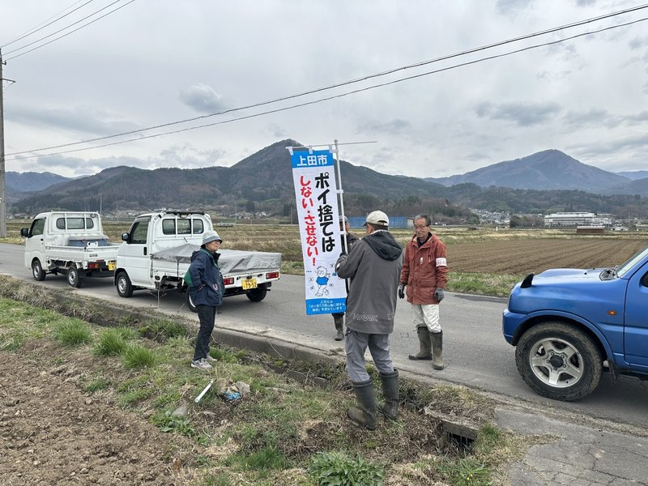

4月23日、24日の2日間、上田市議会臨時会が開催され、私の所属委員会などが決定いたしました。

市議会には、行政の幅広い仕事を効率よく、専門的にチェックするために「常任委員会」という分担制度があります。上田市には現在、次の4つの常任委員会が設置されています。

- 総務委員会：市の将来計画、予算、防災、そして消防など、市政の根幹を担います。
- 教育厚生委員会：子育て支援、福祉、医療、そして学校教育など、市民の一生に寄り添う分野を扱います。
- 産業水道委員会：農業、商業、観光、そして命の水である上下水道など、地域の活力に関わります。
- 環境建設委員会：道路、公園、ゴミ処理、景観づくりなど、街のインフラ整備を担当します。

これらの常任委員会のうち、議員が所属できるのは1つだけです。私は、自分のこれまでの経験と信念に基づき、総務委員会を希望しました。

### 希望どおり、総務委員会へ

前職では工作機械の性能向上や問題解決にあたり、対症療法ではなく根本治療に力を入れてきました。具体的な問題に対し、絆創膏を貼れば一時的には解決できるとしても、そもそも問題が発生しない仕組みをどう作るか、という考え方です。

調査や対策の検討に時間はかかりますが、同様のトラブルを未然に防ぐことで、結果として将来的なコストや負担を最小限に抑えられます。私は、このエンジニアの視点を市政の仕組みづくりに取り入れたいと考えています。

### 地域の主役を、行政の「手足」にしない

もう一つは、地域で活躍する方々の後方支援に取り組みたいという思いです。

自治会や公民館、そして消防団。これらは地域の絆を支える欠かせない存在です。しかし、近年の人口減少や担い手不足の中で、現場の方々の負担が限界に達していることを、私は実感を持って認識しています。

行政の事務的な仕事がそのまま地域に降りてきているような、「行政の手足として動かされている」という感覚。これが活動の負担感をより重くしているのではないでしょうか。

現場の負担を減らすことは、単に仕事を削ることではありません。関わる方々が「自分たちのまちを自分たちで守り、より良くしている」という誇りと使命感を持っていただけるような環境を整えること。それが、私が総務委員会を選んだ大きな動機です。

### 持続可能な行政と公民連携の未来

総務委員会では、持続可能な行政運営に向けた公民連携（官民共同）や、それに必要な人材育成にも取り組んでいます。財政が厳しさを増す中で、行政だけで全てを抱え込むのではなく、民間や地域の力とどう手を取り合っていくか。前年度の委員会からの提言を軸に、市役所の職場環境改善も含め、より効率的で、誰も取り残さない温かい行政サービスが継続できるよう、私も深く関わってまいります。

### 現場から離れない活動を

総務委員会という大きな組織の中にいても、常に地域で活躍する皆さまの最前線へ足を運び、そこでお聞きする声を市政へ届けてまいります。日々の暮らしの中で得られる小さな気づきを政策へと展開することが、今の私に託された仕事であると認識しています。

負担を減らし、誇りを増やす。  
誰もがこの地域に暮らす喜びを感じられるよう、しっかりと取り組んでまいります。

今日も最後までお読みいただき、ありがとうございました！

[過去の記事は、こちら（しおいり通信のトップページ）からお読みいただけます。](https://shioiri.theletter.jp)

塩入友広 (tomohiro@shioiri.jp)
