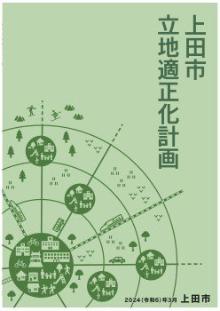
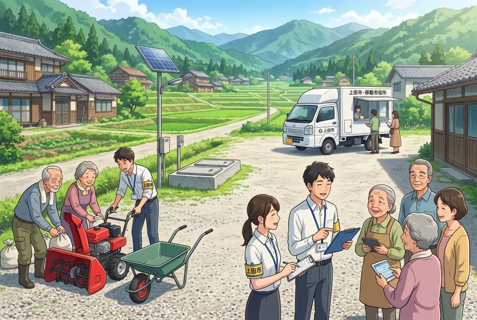

塩入友広です。  
朝晩は寒さを感じるようになってきました。お変わりございませんか。

今日はSNSに流れてきたニュースから、さいきん考えていることに紐づけてお話をさせてください。

マーガレット・ハミルトンという、コンピューターの世界ではよく知られた方が90歳で生涯を終えられました。彼女はアポロ計画で月着陸船を制御するコンピューターのソフトウェア開発を担当していました。

### アポロ11号の危機を救った縮退運転という思想

1969年、アポロ11号が月へ着陸しようとしていたその時、航行装置に予期せぬ問題が発生しました。設計上の問題から、機器がある条件でアンテナが超高速で回転していると錯覚し、毎秒数千回という過剰な割込み処理がコンピューターへ送られ、処理能力の限界を超える寸前に陥ったのです。絶体絶命の状況ですが、マーガレット・ハミルトンはコンピューターがパンクしないよう、そして着陸に向けた動作が切れ目なく行われるよう、ソフトウェアに仕掛けを施しておいたのです。

（初出時、「その時、誤ったスイッチ操作が行われました。手順書が間違っていたのです。（以下略）」と記載しておりましたが、これは俗説で、手順書や操作の誤りではなかったことが判明しましたので、訂正しました。）  
※出典元：[Don Eyles (2004), "Tales from the Lunar Module Guidance Computer"](https://klabs.org/history/apollo_11_alarms/eyles_2004/eyles_2004.htm)

)

一般的な安全設計（フェイルセーフ）であれば、コンピューターの過負荷を検知した時点でシステムを安全に停止させていたでしょう。この場合、世紀の月面着陸は中止です。しかし彼女のプログラムは、飛行の継続に直接必要ではない処理を意図的に切り捨て、月面着陸のために必要な計算に集中するように組まれていました。これをソフトウェア工学の世界では縮退運転といいます。生かすか殺すかの二者択一ではなく、異常があっても機能の核は維持したまま、優先順位の低い処理は段階的に絞るという思想です。

追記：ソフトウェア工学 *software engineering* という用語じたい、彼女が作ったものとされているようです。

### 立地適正化計画が直面する壁

立地適正化計画をご存知でしょうか。私も議員になる前は知らなかったのですが、人口減少下における都市の持続可能性を高めるための政策で、現在、全国の多くの自治体で策定が進んでいます。上田市も将来の人口減少社会に対応した「住みやすい上田市」を実現するため、2019年（平成31年）３月に上田市立地適正化計画を策定し、５年経過した2024年（令和6年）3月に見直しが行われました。現在の計画は、2044年（令和26年）を目標としており、5年毎の見直しを行うとされています。

かんたんに言ってしまうと、人々の暮らしを「居住誘導地域」へ集め、いずれ公共によるインフラ整備のリソースはその範囲内へ集中させていこうという計画です。20年後の将来を見据えると、しっかりと着実に進めていく必要のあるものだとは思いますが、今の私たち、特に中山間地域に暮らす私たちにとっては、この「居住誘導区域」の内か外か、という境界線が、あたかも「維持」か「切り捨て」かという二者択一のように感じられてしまいます。

人口が減った集落に、これまでと同様の完全な公共インフラ（上下水道、道路整備、除雪等）を永続的に提供し続ければ、財政はパンクしてしまいます。一方で、財政難を理由に、ある日突然サービスを打ち切るようなことも許されません。求められているのは、唐突な線引ではないということです。

これは縮退運転と同じ考え方。そう思い、今回の記事を書いています。

### 中山間地域のインフラを、段階的に軟着陸（ソフトランディング）させる

縮退運転の思想を都市の経営へ適用するならば、人口密度の変化や耐用年数に応じて、インフラの仕様を秩序立てて段階的に切り替えていく設計が必要です。

#### 上下水道のスペック転換

耐震補強や老朽化による更新に莫大な費用がかかる末端の管路網は、一律な更新を目指すのではなく、更新の節目で分散型給水設備や合併処理浄化槽といった地域特性に合ったものへと公費助成が移行していきます。

#### 道路・除雪の階層化

行政は基幹となる生活道路の舗装、除雪に集中し、利用頻度の低い枝道では今後、舗装の強度の見直しや、地域住民との共助による保全、小型除雪機の運用へと移行していきます。

#### 行政機能の分散化

地域センター等の拠点を維持することが困難になった場合、例えば移動市役所のような車両の定期巡回や、オンライン端末を地域の集会所へ配置する等、機能の縮退を進めていきます。

### 必要なのは方針の公知と情報共有

どうでしょうか。中山間地の自治会が道路の舗装や除雪を要望しても、優先順位を理由に採択されない、その背景に立地適正化計画の存在を感じないでしょうか。

縮退運転を政策として成立させるには、人口規模や空き家の割合、設備の老朽度など、どういった指標に達したら次の段階へ移行するかという客観的な基準を公知し、対象地域の住民と合意しておくことが必要不可欠です。しかし現状は、財政難を理由にサービスが段階的に削られている、そのようにしか感じられません。それもそのはずで、現在の上田市立地適正化計画には縮退運転の考え方は書かれていないのです。

議論を先送りし、将来世代に老朽化したインフラや財政破綻のツケを回すことは避けなければなりません。壊れるまで無理を続け、ある日突然破綻するのではなく、限られた資源の中で、暮らしの安全という生活の柱は死守しながら、賢く段階的に適正な規模へと軟着陸させる——。かつて人類を月へ導いた合理的な設計思想は、人口減少社会における中山間地域の未来を守るための、現実的で誠実な道しるべとなります。

アポロ11号が月面着陸した1969年に生まれ、マイコンと共に育ち、安全で効率的な工作機械のソフトウェアの設計に携わってきた私は、これからも現場の論理に基づき、市民の皆さんの安心と納得にこだわった制度設計を提言していきたいと考えています。お困りごとや不安なことなど、どうかお聞かせください。今はまだ勉強しながらですが、しっかりとお応えしてまいります。

今日も最後までお読みいただき、ありがとうございました！

[過去の記事は、こちら（しおいり通信のトップページ）からお読みいただけます。](https://shioiri.theletter.jp/)

塩入友広　TEL 090-3558-5540
