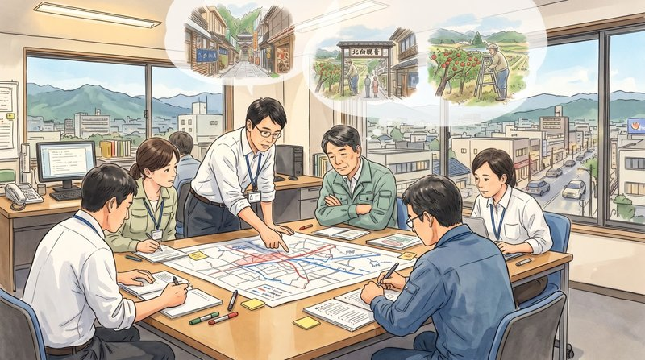
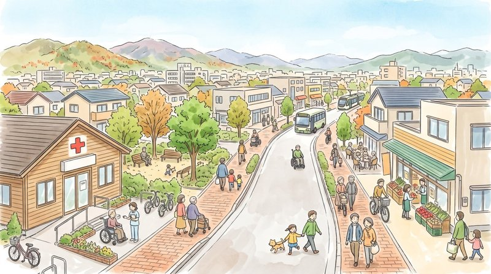
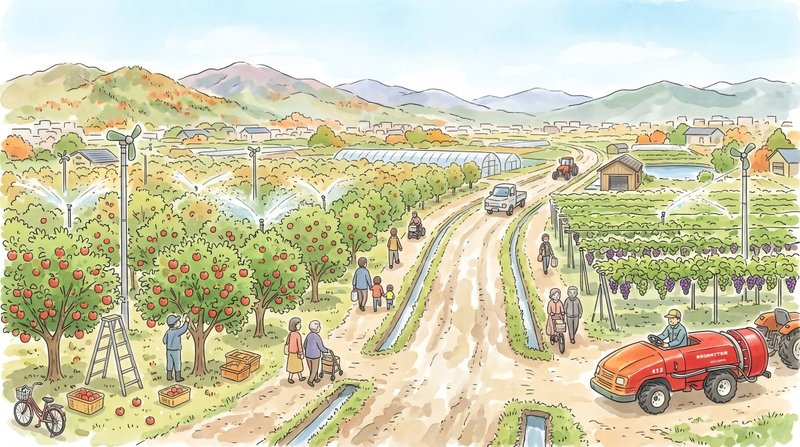

塩入友広です。  
まもなく立冬です。朝晩の冷え込みが厳しくなってきましたが、お変わりございませんか。

10月10日の記事「[立地適正化 vs 中山間地の暮らし](2026101001.html)」に、塩田地区の中山間地で農業を営んでいらっしゃる方からコメントをいただきました。

コンパクトシティという言葉は耳にするが、上田市にもそういう計画があることは、しおいり通信で初めて知った。目標の2044年はかなり近い将来なのに、市民への周知が全然足りていないと感じる。自分も塩田の中山間地に暮らしているので、かなり不安を覚える。農業で生計を立てているので、その将来も非常に心配だ。今の農業は、水や電気などのインフラがある立地でなければ成り立たない。市の動きが本当に鈍く、問題を先送りするつもりなのでは、と穿った見方をしてしまう。そういったお声でした。

いずれも、私自身が議員として感じていることと重なります。ありがとうございます。

最初にお断りしておくと、私も議員という立場ではあるものの、計画のすべてを理解できているわけではありません。今日は、このコメントへの私なりの回答として、現時点で私が確認できた範囲で、立地適正化計画で決まっていることと決まっていないことを分けて整理し、私が取り組んでいきたいことをお伝えします。

## 周知が足りていない、というご指摘について

ご指摘のとおりだと考えます。  
私自身、議員になるまでこの計画を知りませんでした。

上田市立地適正化計画は2019年（平成31年）3月に策定され、2024年（令和6年）3月に改定されました。目標年次は2044年（令和26年）で、おおむね5年ごとに見直すこととされています。計画書は市のホームページで公開されています。（[上田市立地適正化計画](https://www.city.ueda.nagano.jp/uploaded/attachment/57556.pdf)）

5年ごとに見直されるということは、次の見直しに向けて市民が意見を伝える機会がある、ということでもあります。その機会を実際に使えるようにするには、計画の内容が市民に知られていることが前提です。この通信も、計画を知っていただくための一つの機会になればと考えています。

## 計画が決めていること、決めていないこと

不安を正確に捉えるために、まず制度の事実を整理します。私自身の勉強の整理も兼ねていますので、誤りや不足があるかもしれません。コメントまたはメールでご指摘いただけると助かります。

立地適正化計画は国の都市再生特別措置法に基づいて、それぞれの市町村が定める計画です。人口密度を維持し、医療や福祉、買い物などの生活サービスを確保するため、居住誘導区域などを定めます。どの範囲を区域とするかは、国の指針を踏まえて上田市が決めています。

一方で、居住誘導区域の外に住み続けることを制限する効力はありません。区域外で一定規模以上の住宅を開発する場合に、市への届出が必要になるだけです。家の建て替えや改修が禁じられることもありません。

もう一つ、コメントでご心配いただいた農業のインフラについてですが、農業用水やため池、農道、電気は、立地適正化計画とは別の制度で整備・管理されています。つまり、立地適正化計画が農業用水や電気の予算を直接決めるわけではありません。計画の影響が及ぶ可能性があるのは、市が管理する生活インフラの側です。農業を続けるには、道路や公共施設といった暮らしの基盤も欠かせません。私が注視しているのは、この部分です。

## それでも不安が消えないのは、なぜか

法律上の規制がないからといって、不安が杞憂だということにはなりません。区域の外の地域にどのような基準で公共投資を続けるのかが、計画から読み取れないことに課題を感じています。

上田市の居住誘導区域は、上田駅周辺と丸子地域の中心部に設定されています。塩田地区は区域の外です。区域の外にある道路や公共施設を、いつ、どの順番で、どの水準まで維持するのか。前回の記事で、段階を移行する基準を公表し、住民と合意しておく必要があると書いたのは、この点です。

身近なところでは、次のようなことを感じています。

中心市街地では、電線を地中に埋める無電柱化の工事が進んでいます。一方、郊外の自治会が市道の舗装補修を要望しても、なかなか採択されません。（9月30日の記事「[対症療法の繰り返しから「予防保全」へ](2026093001.html)」で触れています）

事業ごとに国の補助制度や財源の仕組みが異なるため、両者を単純に比べることはできませんが、その仕組みや優先順位の決め方が市民に見えていないことは問題だと考えています。

さいきん、私の同級生がかつて住んでいた土地が造成され、数軒の建売住宅が建ちました。しかし、しばらく時間が経った今も、そこには生活の気配が感じられません。モデルハウスとして使われているのか、売りに出ているものの買い手がつかないのか、外から見る限り事情はわかりません。一つの事例から全体を語ることはできませんが、新しく家を建てれば人が住む、という前提が今も成り立つのかどうか、改めて考えさせられています。

「市の動きが鈍い」「問題を先送りしているのでは」というご指摘について、私は、現在の計画の方針が、市民の目に見える具体的な事業や予算として十分に示されていないと考えています。そのために、市民からは先送りに見えてしまうのではないでしょうか。この点は、議会として今後、問うべき課題であると考えています。

## 議員として取り組むこと

人口が減り、市の財源も限られる中で、すべての道路や施設をこれまでどおりの水準で維持し続けることは難しいと考えています。将来世代に過度な負担を残してはならない、というのが私の基本的な姿勢です。私は今後、区域の外の地域に対して、どのような基準と優先順位で公共投資を行うのかを、市民に見える形で示すよう求めていきたいと考えています。基準が示されれば、市民はそれに対して意見を言うことができます。基準が示されないまま、要望が採択されない状態が続くことが一番の問題だと、私は考えています。

なお、私が所属する会派「上志の風」でも、立地適正化計画を具体的な実践へ進めるための議論を重ねており、近く市長に提言を行う予定です。

## 現場の声を聞くことから

田畑やため池、水路は、人が住む家のように移動させることができません。今の、この場所で農業を続けるために欠かせないものは何か。農業の経験がない私は、現場で働く方からいろいろと教えていただかなければなりません。たとえば、作業に支障が出るほど傷んだ道路や施設はないか、担い手や後継ぎについて10年後、20年後をどう見通しているか。直接お話を伺えればと考えています。

冒頭でご紹介したコメントには、「わたしたち市民は議員さん達が頼みの綱です」という励ましのお言葉も添えられていました。重く受け止めています。議員にできることは、市民の声と事実をもとに市へ問いかけ、その答えを市民にお伝えすることです。私自身も勉強を重ねながら、その役割を地道に果たしていきます。

お困りごとや不安なことがあれば、コメントやメール、お電話でお聞かせください。

今日も最後までお読みいただき、ありがとうございました！

[過去の記事は、こちら（しおいり通信のトップページ）からお読みいただけます。](https://shioiri.theletter.jp/)

塩入友広　TEL 090-3558-5540
